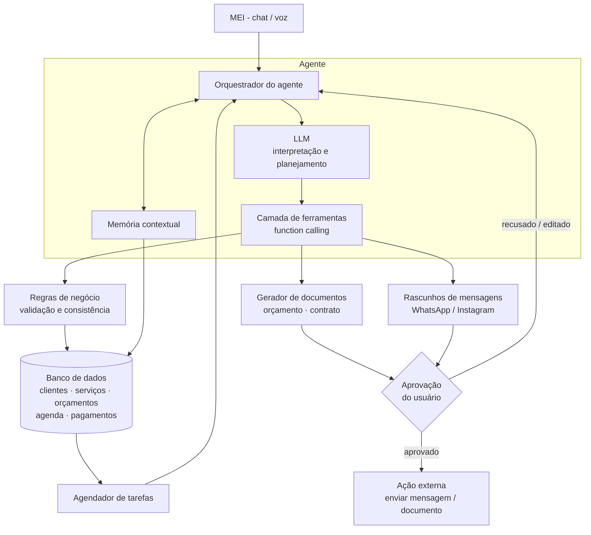
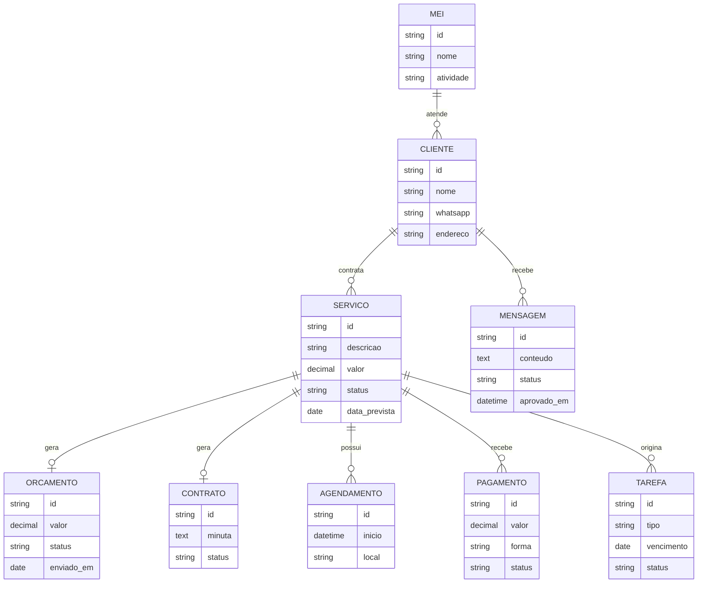

<div align="center">

<h1>MEIagente</h1>

<p>
Assistente administrativo, comercial e de marketing para Microempreendedores Individuais.<br/>
O MEI descreve o serviço em uma frase. O agente organiza o resto e só age com a aprovação dele.
</p>

<p>


</p>

<p>
<a href="#1-o-problema">Problema</a>
&nbsp;&middot;&nbsp;
<a href="#2-a-solução">Solução</a>
&nbsp;&middot;&nbsp;
<a href="#3-exemplo-de-uso">Exemplo</a>
&nbsp;&middot;&nbsp;
<a href="#5-arquitetura">Arquitetura</a>
&nbsp;&middot;&nbsp;
<a href="#9-segurança-privacidade-e-lgpd">Segurança</a>
&nbsp;&middot;&nbsp;
<a href="#14-como-rodar">Como rodar</a>
</p>

</div>

<br/>

> [!NOTE]
> **Status:** MVP em desenvolvimento para o AKCIT Camp (hackathon). O banco de domínio e o cadastro inicial já estão implementados; chat, telas de consulta e agendador ainda estão em integração.

<br/>

<table>
<tr>
<td width="33%" valign="top">

**Para quem**

Prestadores de serviço que trabalham sozinhos: eletricistas, técnicos de manutenção, fotógrafos e autônomos em geral.

</td>
<td width="33%" valign="top">

**O que resolve**

Orçamento, contrato, confirmação, agenda e follow-up hoje ficam espalhados entre WhatsApp, planilhas e papel.

</td>
<td width="33%" valign="top">

**Como**

Um agente com ferramentas, regras de negócio no banco e aprovação humana antes de qualquer ação externa.

</td>
</tr>
</table>

<br/>

## Sumário

| | | |
|---|---|---|
| [1. O problema](#1-o-problema) | [6. Ferramentas do agente](#6-ferramentas-do-agente) | [11. Validação](#11-validação) |
| [2. A solução](#2-a-solução) | [7. Modelo de dados](#7-modelo-de-dados) | [12. Roadmap](#12-roadmap) |
| [3. Exemplo de uso](#3-exemplo-de-uso) | [8. Escopo do MVP](#8-escopo-do-mvp) | [13. Estrutura do projeto](#13-estrutura-do-projeto) |
| [4. Funcionalidades](#4-funcionalidades) | [9. Segurança, privacidade e LGPD](#9-segurança-privacidade-e-lgpd) | [14. Como rodar](#14-como-rodar) |
| [5. Arquitetura](#5-arquitetura) | [10. Riscos e gaps](#10-riscos-e-gaps) | [15. O papel do AKCIT Camp](#15-o-papel-do-akcit-camp) |

<br/>

## 1. O problema

No Brasil, muitos MEIs acumulam funções: executam o serviço, atendem clientes, fazem orçamentos, elaboram contratos, organizam agenda, divulgam o negócio e acompanham pagamentos. Essa sobrecarga administrativa consome o tempo que deveria ir para a atividade principal e para a conquista de novos clientes.

É especialmente crítico para prestadores de serviço que trabalham sozinhos. O dia a dia costuma rodar em ferramentas desconectadas: WhatsApp, Instagram, planilhas e documentos soltos.

#### O que dizem as pesquisas do Sebrae (recorte MEI)

| Indicador | Valor | Fonte |
|:---|:---:|:---:|
| Usam IA regularmente em marketing e comunicação | **29%** | [1] |
| Já fizeram testes com IA | **23%** | [1] |
| Não usam, mas pretendem usar em breve | **28%** | [1] |
| Apontam como principal obstáculo não saber como aplicar IA no negócio | **23%** | [2] |

<sub>
[1] Sebrae, <i>Pulso dos Pequenos Negócios</i>, 13ª edição (nov/2026). <a href="https://agenciasebrae.com.br/?p=43963">agenciasebrae.com.br</a><br/>
[2] Sebrae, FGV IBRE e Google. Coleta em set/2025, cerca de 5.000 empresas (jan/2026). <a href="https://agenciasebrae.com.br/dados/pequenos-negocios-abracam-a-inteligencia-artificial-para-otimizar-o-tempo-e-inovar/">agenciasebrae.com.br</a><br/>
Em Pernambuco, 25% dos empreendedores usam IA regularmente em marketing e comunicação e 32% planejam usar em breve (Pulso, 13ª edição). <a href="https://www.diariodepernambuco.com.br/economia/2026/10/11726740-pesquisa-do-sebrae-indica-que-25-dos-empreendedores-pernambucanos-usam-ia-nos-negocios.html">Diário de Pernambuco</a>
</sub>

<br/><br/>

**Oportunidade:** tornar a IA útil para quem não tem conhecimento técnico, integrando-a diretamente às tarefas do cotidiano.

<br/>

## 2. A solução

Uma plataforma de gestão apoiada por um agente de IA que entende o que o microempreendedor precisa, organiza processos e executa fluxos de trabalho com a autorização dele.

O agente não é só um chatbot que gera texto. Ele:

- tem acesso ao contexto autorizado do negócio;
- usa ferramentas para consultar e atualizar registros;
- planeja sequências de ações;
- acompanha processos ao longo do tempo.

| Automação convencional | Agente |
|:---|:---|
| Segue fluxos fixos | Interpreta linguagem natural |
| Exige dados completos | Lida com informação incompleta e pergunta o que falta |
| Um caminho por tarefa | Escolhe as ferramentas e adapta o plano a cada serviço |

> [!IMPORTANT]
> A IA interpreta e prepara as ações. As regras de negócio garantem a consistência dos registros. Qualquer ação externa, como enviar uma mensagem ou um documento, só acontece depois da aprovação do usuário.

<br/>

## 3. Exemplo de uso

Um técnico de manutenção escreve, em linguagem natural:

> Fechei uma instalação de ar-condicionado por R$ 800 para sexta-feira.

A partir dessa única mensagem:

| Etapa | O que o agente faz |
|:---|:---|
| **1. Interpreta** | Serviço: instalação de ar-condicionado. Valor: R$ 800. Data: sexta-feira. |
| **2. Verifica** | Faltam nome do cliente, telefone, endereço e forma de pagamento. |
| **3. Pergunta** | "Qual o nome e o WhatsApp do cliente? O pagamento é à vista ou parcelado?" |
| **4. Prepara** | Orçamento, minuta de contrato, mensagem de confirmação e agendamento. |
| **5. Pede aprovação** | Cada item aparece num cartão com as opções Aprovar, Editar e Descartar. |

#### Conversa

```text
MEI      Fechei uma instalação de ar-condicionado por R$ 800 para sexta.

Agente   Entendi. Já registrei o serviço para sexta-feira (R$ 800).
         Para continuar preciso de:
           - Nome e WhatsApp do cliente
           - Endereço da instalação
           - Pagamento: à vista, Pix ou parcelado?

MEI      Maria Souza, 62 9XXXX-XXXX, Setor Bueno. Pix na entrega.

Agente   Preparei 3 itens para você revisar:
           1. Orçamento #012 (R$ 800, Pix na entrega)
           2. Minuta de contrato de prestação de serviço
           3. Mensagem de confirmação para a Maria:

              "Olá, Maria! Confirmando a instalação do ar-condicionado
               na sexta-feira, no Setor Bueno. Valor combinado: R$ 800,
               pagamento via Pix na entrega. Qualquer dúvida, é só chamar."

         [ Aprovar ]  [ Editar ]  [ Descartar ]
```

#### Acompanhamento posterior

Dias depois, o agente percebe que uma proposta continua sem resposta e sugere o próximo passo:

```text
Agente   O orçamento #009 (Carlos, troca de fiação, R$ 450) está há
         4 dias sem resposta. Sugiro este lembrete:

         "Oi, Carlos, tudo bem? Passando para saber se conseguiu ver o
          orçamento da troca de fiação. Posso ajustar o que precisar."

         [ Enviar ]  [ Editar ]  [ Ignorar ]
```

<sub>As mensagens e documentos acima são exemplos ilustrativos do comportamento esperado.</sub>

<br/>

## 4. Funcionalidades

| Área | O que o agente faz |
|:---|:---|
| **Atendimento e relacionamento** | Redige mensagens personalizadas para WhatsApp, confirma serviços, envia lembretes e acompanha propostas comerciais. |
| **Documentação** | Gera orçamentos, propostas e minutas de contrato de prestação de serviços a partir dos dados cadastrados. |
| **Marketing digital** | Sugere posts, legendas, campanhas e estratégias de divulgação adaptadas à atividade do MEI. |
| **Gestão operacional** | Organiza clientes, serviços e agendamentos; identifica tarefas pendentes. |
| **Acompanhamento financeiro** | Apoia o registro de valores, pagamentos e cobranças, com ampliação futura. |

<br/>

## 5. Arquitetura

Componentes: LLM, banco de dados, memória contextual, ferramentas de execução (function calling) e orquestrador de tarefas.



#### Fluxo de uma solicitação

1. O usuário envia uma mensagem em linguagem natural.
2. O orquestrador monta o contexto (histórico e dados do negócio) e chama o LLM.
3. O LLM decide quais ferramentas chamar e em que ordem.
4. As regras de negócio validam cada escrita no banco.
5. Ações externas ficam como rascunho até o usuário aprovar.
6. Um agendador revisita pendências, como propostas sem resposta, e reativa o agente.

<br/>

## 6. Ferramentas do agente

<details>
<summary><b>Ver a lista de ferramentas (function calling)</b></summary>
<br/>

Lista proposta. Nomes e assinaturas podem mudar na implementação.

| Ferramenta | Função | Escreve dados | Exige aprovação |
|:---|:---|:---:|:---:|
| `buscar_cliente(nome\|telefone)` | Consulta cadastro de clientes | não | não |
| `criar_ou_atualizar_cliente(dados)` | Cadastra ou edita um cliente | sim | não |
| `registrar_servico(cliente_id, descricao, valor, data)` | Cria o serviço ou pedido | sim | não |
| `listar_dados_faltantes(servico_id)` | Aponta o que ainda falta para fechar o serviço | não | não |
| `gerar_orcamento(servico_id)` | Cria o orçamento | sim | revisão |
| `gerar_minuta_contrato(servico_id)` | Cria a minuta contratual | sim | revisão |
| `redigir_mensagem(cliente_id, objetivo)` | Gera rascunho de mensagem | rascunho | para enviar |
| `agendar_servico(servico_id, data, hora)` | Registra na agenda | sim | não |
| `listar_propostas_pendentes(dias_sem_resposta)` | Acha propostas paradas | não | não |
| `registrar_pagamento(servico_id, valor, forma)` | Lança recebimento | sim | não |
| `sugerir_post_instagram(atividade, objetivo)` | Ideias de conteúdo e legendas | não | não |
| `enviar_mensagem(rascunho_id)` | Envio real (fase pós-MVP) | externo | sim |

</details>

<br/>

## 7. Modelo de dados

<details>
<summary><b>Ver o diagrama entidade-relacionamento</b></summary>
<br/>



</details>

**Estados de um serviço**

`rascunho` → `orçado` → `aguardando resposta` → `confirmado` → `agendado` → `executado` → `pago`

<br/>

## 8. Escopo do MVP

Foco no ciclo completo de atendimento, usando dados cadastrados e de demonstração, sem integrações externas complexas nesta primeira versão.

<table>
<tr>
<th align="left" width="50%">Entra no MVP</th>
<th align="left" width="50%">Fica para depois</th>
</tr>
<tr>
<td valign="top">

- Cadastro de cliente
- Descrição do serviço em linguagem natural
- Geração de orçamento
- Rascunho de mensagem de WhatsApp (copiar e colar, sem envio automático)
- Geração de minuta contratual
- Detecção de propostas pendentes e sugestão de ação comercial
- Aprovação do usuário antes de qualquer ação externa

</td>
<td valign="top">

- Integração real com as APIs do WhatsApp e do Instagram
- Módulo financeiro completo
- Multiusuário e múltiplos MEIs com autenticação
- Assinatura digital de contratos

</td>
</tr>
</table>

<br/>

## 9. Segurança, privacidade e LGPD

| Princípio | Compromisso |
|:---|:---|
| **Aprovação humana** | Obrigatória para envio de mensagens e documentos. |
| **Minimização de dados** | O agente acessa apenas o contexto autorizado do negócio. |
| **LGPD** | Dados pessoais de clientes finais (nome, telefone, endereço) com base legal definida, finalidade clara e possibilidade de exclusão. |
| **Controle de custo e abuso** | Limites de uso e monitoramento do custo de inferência. |
| **Rastreabilidade** | Registro de quais ações o agente propôs e quais o usuário aprovou. |

> [!CAUTION]
> Minutas geradas por IA são ponto de partida. Devem ser revisadas e não substituem orientação jurídica.

#### Como isso está implementado

| O que protege | Como funciona | Onde está |
|:---|:---|:---|
| **Nada sai sem o MEI aprovar** | Orçamento, contrato e mensagem nascem como `rascunho` e só viram `aprovado` ou `descartado` por decisão do usuário no cartão. Decisão repetida não muda nada. No MVP não há envio automático: a mensagem é copiada e colada. | `supabase/04-documentos.sql` (`item_decidir`), `src/app/painel/agente/Cartao.tsx` |
| **Documento aprovado não é refeito** | O banco recusa regerar orçamento ou contrato já aprovado. | `supabase/04-documentos.sql` |
| **Entrada do modelo validada** | Cada uma das 16 ferramentas tem esquema `zod`; entrada inválida não executa e volta ao modelo como `entrada_invalida`. | `src/lib/agente/ferramentas/executar.ts` |
| **Regras de negócio no banco** | A IA interpreta; as funções SQL garantem estados do serviço e evitam cliente duplicado. | `supabase/02..05-*.sql` |
| **Teto de etapas por pedido** | No máximo 8 voltas do modelo por mensagem do usuário. | `src/lib/agente/loop.ts` (`MAX_VOLTAS`) |
| **Teto de custo por dia** | Limite diário de tokens por MEI (padrão 400 mil, `AGENTE_LIMITE_DIARIO_TOKENS`). | `src/lib/agente/uso.ts` |
| **Histórico consistente** | Volta que falha no meio (filtro, corte, erro de rede) não é gravada; a conversa segue utilizável. | `src/lib/agente/loop.ts` |
| **Histórico limitado** | No máximo 40 mensagens ou 40 mil caracteres enviados ao modelo. | `src/lib/agente/llm.ts` (`limitarHistorico`) |
| **Auditoria** | Toda chamada de ferramenta e toda decisão do usuário ficam em `agente_acoes` (entrada, saída, erro, autor), com RLS. | `supabase/06-agente.sql` |
| **Erros compreensíveis** | Toda falha (limite de taxa, conversa longa, filtro, limite do dia) chega ao MEI como mensagem em português, com o que fazer em seguida. | `src/lib/agente/llm.ts`, `src/lib/agente/loop.ts` |

#### Como medimos a qualidade

| Camada | Como | Situação |
|:---|:---|:---|
| **Testes automáticos** | 308 testes (`npm test`) com um LLM falso, que segue um roteiro, e banco PGlite em memória. Cobrem o laço do agente, as ferramentas, as regras SQL, os documentos e a rota do chat, sem gastar crédito. | Passando |
| **Aceitação com o modelo real** | `scripts/agente-smoke.ts` roda o cenário da seção 3 contra o modelo. Esperado: 3 cartões, serviço `confirmado` e nenhuma `entrada_invalida`. | Script pronto |
| **Métricas de produto** | As da seção 11, medidas na fase de validação com MEIs reais. | Fase 2 |

<br/>

## 10. Riscos e gaps

| Tipo | Desafio |
|:---|:---|
| **Técnico** | Arquitetura de agentes, memória contextual confiável, orquestração de ferramentas, custo de inferência e segurança dos dados. |
| **Operacional** | Viabilidade de integração com WhatsApp e Instagram; fluxos simples de aprovação e execução. |
| **Negócio** | Entrevistar MEIs de diferentes segmentos, priorizar tarefas de maior impacto, validar a experiência de uso e investigar disposição a pagar. |
| **Validação** | Medir tempo economizado, facilidade de uso e efetividade do acompanhamento comercial. |

> [!NOTE]
> **Hipótese inicial, a ser testada com usuários reais:** uma ferramenta especializada, simples e integrada à rotina do empreendedor pode reduzir atividades administrativas repetitivas.

<br/>

## 11. Validação

| Métrica | Como medir |
|:---|:---|
| Tempo para gerar orçamento e contrato | Cronometrar antes (manual) e depois (com o agente) |
| Facilidade de uso | Teste com MEIs reais e questionário (ex.: SUS simplificado) |
| Efetividade do follow-up | Percentual de propostas pendentes que receberam resposta após o lembrete sugerido |
| Qualidade dos documentos | Revisão por pessoa com conhecimento jurídico |
| Disposição a pagar | Entrevistas estruturadas por segmento |

<br/>

## 12. Roadmap

| Fase | Entrega |
|:---|:---|
| **1. MVP (hackathon)** | Ciclo completo: cliente → serviço → orçamento → mensagem → minuta → pendências, com dados de demonstração. |
| **2. Validação** | Testes com MEIs reais (eletricistas, técnicos, fotógrafos); ajuste de fluxos e linguagem. |
| **3. Integrações** | WhatsApp e Instagram, com envio após aprovação. |
| **4. Financeiro** | Cobranças, lembretes de pagamento e visão de fluxo de caixa. |
| **5. Escala** | Autenticação, multiusuário, modelo de preço acessível e controle de custos. |

<br/>

## 13. Estrutura do projeto

<details>
<summary><b>Ver as pastas principais</b></summary>
<br/>

```text
MEI-agente-/
├── src/
│   ├── app/
│   │   ├── api/            rotas: chat, cron de pendências, health
│   │   ├── painel/         telas: agente, agenda, clientes, serviços,
│   │   │                   documentos, mensagens, negócio
│   │   ├── login/          entrada
│   │   └── setup/          primeiro acesso
│   └── lib/
│       ├── agente/         laço, prompt, contexto, cliente do modelo, uso
│       │   └── ferramentas/  definições e executor das ferramentas
│       ├── documentos/     orçamento, contrato e formatação
│       ├── dominio/        tipos e regras do MEI
│       └── auth/           sessão, senha e limite de login
├── supabase/               SQL em ordem (01-auth ... 08-proatividade, 90-cron)
│   └── seed/               dados de demonstração
├── tests/                  agente, documentos, domínio e SQL (PGlite)
├── scripts/                smoke HTTP e smoke do agente
└── docs/                   plano de implementação
```

</details>

<br/>

## 14. Como rodar

**1. Banco.** Crie um projeto no Supabase. No SQL Editor, execute, em ordem, os arquivos `supabase/01-auth.sql` a `supabase/08-proatividade.sql`.

> [!TIP]
> O `90-cron.sql` é para o agendamento em produção e não é necessário para rodar localmente: ele usa `pg_cron` e `pg_net` e precisa que você troque `<APP_URL>` e `<CRON_SECRET>` antes de rodar (sem commitar o resultado). Localmente, o botão **Verificar agora** do Início faz o mesmo que o agendamento.

**2. Variáveis.** Copie `.env.example` para `.env.local` e preencha `SUPABASE_URL`, `SUPABASE_SERVICE_ROLE_KEY`, `SESSION_SECRET`, `CRON_SECRET` e `FEATHERLESS_API_KEY`. Use `AGENTE_MODELO=google/gemma-4-31B-it`. A service role key deve ficar apenas no servidor. Não há `APP_URL`.

**3. Aplicação.**

```bash
npm install
npm run dev
```

Abra `http://localhost:3000/setup`, crie seu usuário e complete o cadastro do negócio na tela seguinte.

**4. Demonstração.** Abra `supabase/seed/demo.sql`, substitua `<EMAIL_DO_USUARIO>` pelo email usado em `/setup` e execute o arquivo no SQL Editor. O seed pode ser executado mais de uma vez; ele cria o MEI Refrigeração Bueno, cinco clientes, um serviço pago, um agendamento para amanhã e a proposta #009 de Carlos parada há quatro dias.

**5. Smoke.** Quando as rotas de chat e agendador estiverem disponíveis, execute `./scripts/smoke.sh` com o servidor local em execução para conferir as respostas HTTP sem sessão.

#### Verificação sem banco real nem chamada ao modelo

```bash
npm test
npm run lint
```

`npm run build` também precisa das variáveis de `.env.local`; valores fictícios bastam para o build local.

<br/>

## 15. O papel do AKCIT Camp

O hackathon é a oportunidade de transformar a proposta em um protótipo tecnicamente consistente e com potencial de aplicação comercial.

| | |
|:---|:---|
| **Capacitações** | Agentes de IA, LLMs, RAG, function calling e orquestração alimentam diretamente a arquitetura e os fluxos do agente. |
| **Entrega alvo** | Uma jornada completa de atendimento, em que o agente interpreta a demanda, usa ferramentas, mantém contexto e sugere próximas ações. |
| **Mentorias** | Avaliação de viabilidade técnica, custos de operação, experiência do usuário e evolução do produto. |
| **Meta de negócio** | Uma solução economicamente acessível para microempreendedores, respeitando as limitações desse público. |

<br/>

## Licença

A definir.

<br/>

<div align="center">
<sub>Desenvolvido para o AKCIT Camp 2026, Edição Regional Nordeste, Recife.</sub>
</div>
