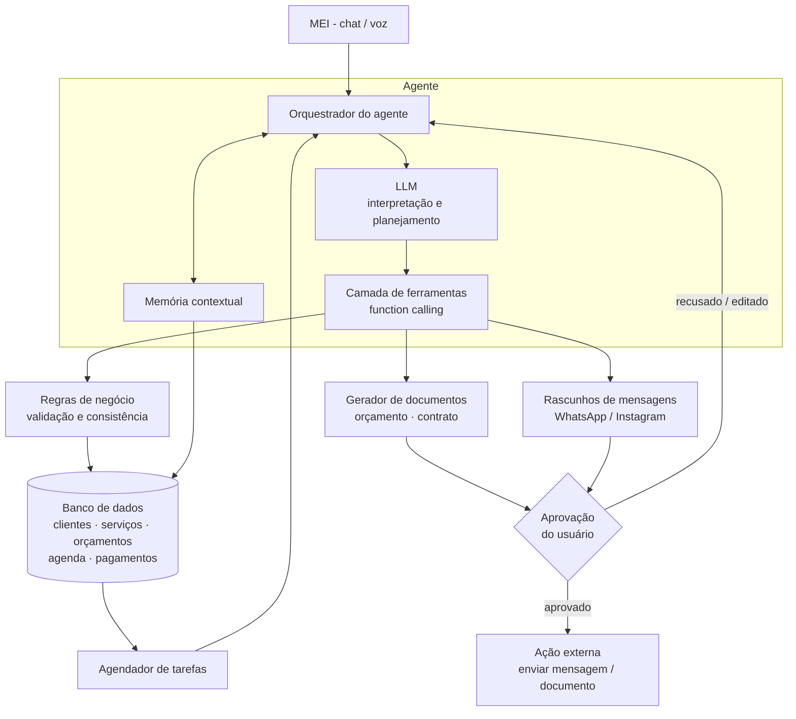
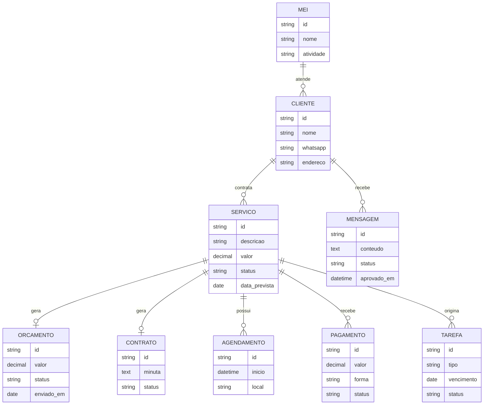

# MEIagente

> Um agente de IA que funciona como assistente administrativo, comercial e de marketing para Microempreendedores Individuais (MEIs).

**Status:** MVP em desenvolvimento para o **AKCIT Camp (hackathon)**. O banco de domínio e o cadastro inicial já estão implementados; chat, telas de consulta e agendador ainda estão em integração.

---

## Sumário

1. [O problema](#1-o-problema)
2. [A solução](#2-a-solução)
3. [Exemplo de uso](#3-exemplo-de-uso)
4. [Funcionalidades](#4-funcionalidades)
5. [Arquitetura proposta](#5-arquitetura-proposta)
6. [Ferramentas do agente (function calling)](#6-ferramentas-do-agente-function-calling)
7. [Modelo de dados inicial](#7-modelo-de-dados-inicial)
8. [Escopo do MVP](#8-escopo-do-mvp)
9. [Segurança, privacidade e LGPD](#9-segurança-privacidade-e-lgpd)
10. [Riscos e gaps](#10-riscos-e-gaps)
11. [Validação](#11-validação)
12. [Roadmap](#12-roadmap)
13. [Estrutura de pastas sugerida](#13-estrutura-de-pastas-sugerida)
14. [Como rodar](#14-como-rodar)
15. [O papel do AKCIT Camp](#15-o-papel-do-akcit-camp)

---

## 1. O problema

No Brasil, muitos MEIs acumulam funções: executam o serviço, atendem clientes, fazem orçamentos, elaboram contratos, organizam agenda, divulgam o negócio e acompanham pagamentos. Essa sobrecarga administrativa consome o tempo que deveria ir para a atividade principal e para a conquista de novos clientes.

É especialmente crítico para prestadores de serviço que trabalham sozinhos: **eletricistas, técnicos de manutenção, fotógrafos e autônomos em geral**. O dia a dia costuma rodar em ferramentas desconectadas: WhatsApp, Instagram, planilhas e documentos soltos.

**O que dizem as pesquisas do Sebrae (citadas na proposta):**

| Indicador (2026) | Valor |
|---|---|
| MEIs que já usam IA regularmente em marketing e comunicação | 29% |
| MEIs que já fizeram testes com IA | 23% |
| MEIs que pretendem adotar IA | 28% |
| MEIs que apontam como obstáculo a dificuldade de saber **como aplicar** IA | 23% |

**Oportunidade:** tornar a IA útil para quem não tem conhecimento técnico, integrando-a diretamente às tarefas do cotidiano.

---

## 2. A solução

Uma plataforma de gestão apoiada por um **agente de IA** que entende o que o microempreendedor precisa, organiza processos e executa fluxos de trabalho **com a autorização dele**.

**O diferencial:** o agente não é só um chatbot que gera texto. Ele:

- tem acesso ao **contexto autorizado** do negócio;
- usa **ferramentas** para consultar e atualizar registros;
- **planeja** sequências de ações;
- **acompanha processos ao longo do tempo**.

**Agente × automação convencional:** uma automação tradicional segue fluxos fixos. O agente interpreta linguagem natural, lida com informações incompletas, escolhe as ferramentas certas e adapta o plano a cada serviço.

**Princípio de segurança:** a IA *interpreta e prepara* as ações; **regras de negócio** garantem a consistência dos registros; e qualquer ação externa (envio de mensagem ou documento) **só acontece após aprovação do usuário**.

---

## 3. Exemplo de uso

### Cenário

Um técnico de manutenção escreve, em linguagem natural:

> "Fechei uma instalação de ar-condicionado por R$ 800 para sexta-feira."

### O que o agente faz a partir dessa única mensagem

```
┌──────────────────────────────────────────────────────────────┐
│ 1. Interpreta   → serviço: instalação de ar-condicionado     │
│                   valor: R$ 800 · data: sexta-feira          │
│                                                              │
│ 2. Verifica     → faltam: nome do cliente, endereço,         │
│                   forma de pagamento, telefone               │
│                                                              │
│ 3. Pergunta     → "Qual o nome e o WhatsApp do cliente?      │
│                    O pagamento é à vista ou parcelado?"      │
│                                                              │
│ 4. Prepara      → orçamento · minuta de contrato ·           │
│                   mensagem de confirmação · agendamento      │
│                                                              │
│ 5. Pede         → "Posso enviar a confirmação ao cliente?"   │
│    aprovação      [Aprovar] [Editar] [Descartar]             │
└──────────────────────────────────────────────────────────────┘
```

### Exemplo de conversa

```text
MEI:     Fechei uma instalação de ar-condicionado por R$ 800 para sexta.

Agente:  Entendi! Já registrei o serviço para sexta-feira (R$ 800).
         Para continuar preciso de:
           • Nome e WhatsApp do cliente
           • Endereço da instalação
           • Pagamento: à vista, Pix ou parcelado?

MEI:     Maria Souza, 62 9XXXX-XXXX, Setor Bueno. Pix na entrega.

Agente:  Prontinho. Preparei 3 itens para você revisar:
           1. 📄 Orçamento #012 (R$ 800, Pix na entrega)
           2. 📑 Minuta de contrato de prestação de serviço
           3. 💬 Mensagem de confirmação para a Maria:

              "Olá, Maria! Confirmando a instalação do ar-condicionado
               na sexta-feira, no Setor Bueno. Valor combinado: R$ 800,
               pagamento via Pix na entrega. Qualquer dúvida, é só chamar!"

         Posso enviar? [Aprovar] [Editar] [Descartar]
```

### Acompanhamento posterior (proatividade)

Dias depois, o agente percebe que uma proposta continua sem resposta e sugere o próximo passo:

```text
Agente:  O orçamento #009 (Carlos, troca de fiação, R$ 450) está há
         4 dias sem resposta. Sugiro este lembrete:

         "Oi, Carlos! Tudo bem? Passando para saber se conseguiu ver o
          orçamento da troca de fiação. Posso ajustar o que precisar. 😊"

         [Enviar] [Editar] [Ignorar]
```

> As mensagens e documentos acima são **exemplos ilustrativos** do comportamento esperado.

---

## 4. Funcionalidades

| Área | O que o agente faz |
|---|---|
| **Atendimento e relacionamento** | Redige mensagens personalizadas para WhatsApp, confirma serviços, envia lembretes e acompanha propostas comerciais. |
| **Documentação** | Gera orçamentos, propostas e minutas de contrato de prestação de serviços a partir dos dados cadastrados. |
| **Marketing digital** | Sugere posts, legendas, campanhas e estratégias de divulgação adaptadas à atividade do MEI. |
| **Gestão operacional** | Organiza clientes, serviços e agendamentos; identifica tarefas pendentes. |
| **Acompanhamento financeiro** | Apoia o registro de valores, pagamentos e cobranças (com ampliação futura). |

---

## 5. Arquitetura proposta

Componentes: **LLM**, **banco de dados**, **memória contextual**, **ferramentas de execução (function calling)** e **orquestrador de tarefas**.



### Fluxo de uma solicitação

1. O usuário envia uma mensagem em linguagem natural.
2. O orquestrador monta o contexto (histórico + dados do negócio) e chama o LLM.
3. O LLM decide **quais ferramentas** chamar e **em que ordem**.
4. As regras de negócio validam cada escrita no banco.
5. Ações externas ficam como **rascunho** até o usuário aprovar.
6. Um agendador revisita pendências (ex.: propostas sem resposta) e reativa o agente.

---

## 6. Ferramentas do agente (function calling)

Lista **proposta** (nomes e assinaturas podem mudar na implementação):

| Ferramenta | Função | Escreve dados? | Exige aprovação? |
|---|---|:---:|:---:|
| `buscar_cliente(nome\|telefone)` | Consulta cadastro de clientes | não | não |
| `criar_ou_atualizar_cliente(dados)` | Cadastra ou edita um cliente | sim | não |
| `registrar_servico(cliente_id, descricao, valor, data)` | Cria o serviço/pedido | sim | não |
| `listar_dados_faltantes(servico_id)` | Aponta o que ainda falta para fechar o serviço | não | não |
| `gerar_orcamento(servico_id)` | Cria o orçamento | sim | revisão |
| `gerar_minuta_contrato(servico_id)` | Cria a minuta contratual | sim | revisão |
| `redigir_mensagem(cliente_id, objetivo)` | Gera rascunho de mensagem | sim (rascunho) | **sim** p/ enviar |
| `agendar_servico(servico_id, data, hora)` | Registra na agenda | sim | não |
| `listar_propostas_pendentes(dias_sem_resposta)` | Acha propostas paradas | não | não |
| `registrar_pagamento(servico_id, valor, forma)` | Lança recebimento | sim | não |
| `sugerir_post_instagram(atividade, objetivo)` | Ideias de conteúdo e legendas | não | não |
| `enviar_mensagem(rascunho_id)` | Envio real (fase pós-MVP) | externo | **sim** |

---

## 7. Modelo de dados inicial



**Estados sugeridos de um serviço:** `rascunho → orçado → aguardando resposta → confirmado → agendado → executado → pago`.

---

## 8. Escopo do MVP

Foco no **ciclo completo de atendimento**, usando **dados cadastrados e de demonstração**, **sem integrações externas complexas** nesta primeira versão.

**Entra no MVP:**

- [ ] Cadastro de cliente
- [ ] Descrição do serviço em linguagem natural
- [ ] Geração de orçamento
- [ ] Rascunho de mensagem de WhatsApp (copiar/colar, sem envio automático)
- [ ] Geração de minuta contratual
- [ ] Detecção de propostas pendentes e sugestão de ação comercial
- [ ] Fluxo de aprovação do usuário antes de qualquer ação "externa"

**Fica para depois:**

- Integração real com API do WhatsApp e do Instagram
- Módulo financeiro completo
- Multiusuário e múltiplos MEIs com autenticação
- Assinatura digital de contratos

---

## 9. Segurança, privacidade e LGPD

- **Aprovação humana** obrigatória para envio de mensagens e documentos.
- **Minimização de dados:** o agente acessa apenas o contexto autorizado do negócio.
- **LGPD:** tratamento de dados pessoais de clientes finais (nome, telefone, endereço) com base legal definida, finalidade clara e possibilidade de exclusão.
- **Documentos jurídicos:** minutas geradas por IA são **ponto de partida**, devem ser **revisadas** e não substituem orientação jurídica.
- **Controle de custo e abuso:** limites de uso e monitoramento do custo de inferência.
- **Rastreabilidade:** registrar quais ações o agente propôs e quais o usuário aprovou.

---

## 10. Riscos e gaps

| Tipo | Desafio |
|---|---|
| **Técnico** | Definir a arquitetura de agentes; memória contextual confiável; orquestração de ferramentas; controle de custo de inferência; segurança dos dados. |
| **Operacional** | Viabilidade de integração com WhatsApp e Instagram; fluxos simples de aprovação e execução. |
| **Negócio** | Entrevistar MEIs de diferentes segmentos; priorizar tarefas de maior impacto; validar a experiência de uso; investigar disposição a pagar. |
| **Validação** | Medir tempo economizado, facilidade de uso e efetividade do acompanhamento comercial. |

**Hipótese inicial (a ser testada com usuários reais):** uma ferramenta especializada, simples e integrada à rotina do empreendedor pode reduzir atividades administrativas repetitivas.

---

## 11. Validação

Métricas propostas para testar a hipótese:

| Métrica | Como medir |
|---|---|
| Tempo para gerar um orçamento + contrato | Cronometrar antes (manual) × depois (com o agente) |
| Facilidade de uso | Teste com MEIs reais + questionário (ex.: SUS simplificado) |
| Efetividade do follow-up | % de propostas pendentes que receberam resposta após o lembrete sugerido |
| Qualidade dos documentos | Revisão por pessoa com conhecimento jurídico |
| Disposição a pagar | Entrevistas estruturadas por segmento |

---

## 12. Roadmap

| Fase | Entrega |
|---|---|
| **1 – MVP (hackathon)** | Ciclo completo: cliente → serviço → orçamento → mensagem → minuta → pendências, com dados de demonstração. |
| **2 – Validação** | Testes com MEIs reais (eletricistas, técnicos, fotógrafos); ajuste de fluxos e linguagem. |
| **3 – Integrações** | WhatsApp e Instagram (envio com aprovação). |
| **4 – Financeiro** | Cobranças, lembretes de pagamento e visão de fluxo de caixa. |
| **5 – Escala** | Autenticação, multiusuário, modelo de preço acessível, controle de custos. |

---

## 13. Estrutura de pastas sugerida

> Sugestão inicial, independente de stack. Ajuste conforme a tecnologia escolhida.

```text
MEIagente/
├── README.md
├── docs/
│   ├── arquitetura.md
│   ├── fluxos-do-agente.md
│   └── entrevistas-mei.md
├── src/
│   ├── agent/            # orquestrador, prompts, planejamento
│   ├── tools/            # funções chamadas via function calling
│   ├── memory/           # memória contextual
│   ├── domain/           # entidades e regras de negócio
│   ├── documents/        # templates de orçamento e contrato
│   └── api/              # interface (chat / endpoints)
├── data/
│   └── seed/             # dados de demonstração
├── tests/
└── .env.example
```

---

## 14. Como rodar

1. Crie um projeto no Supabase. No **SQL Editor**, execute, em ordem, os arquivos `supabase/01-auth.sql` a `supabase/07-consultas.sql` que estiverem presentes nesta versão. O `90-cron.sql` é para o agendamento em produção e não é necessário para rodar localmente.
2. Copie `.env.example` para `.env.local` e preencha `SUPABASE_URL`, `SUPABASE_SERVICE_ROLE_KEY`, `SESSION_SECRET`, `CRON_SECRET` e `FEATHERLESS_API_KEY`. Use `AGENTE_MODELO=google/gemma-4-31B-it`. A service role key deve ficar apenas no servidor. Não há `APP_URL`.
3. Rode `npm install` e `npm run dev`; abra `http://localhost:3000/setup` e crie seu usuário. Complete o cadastro do negócio na tela seguinte.
4. Para carregar a demonstração, abra `supabase/seed/demo.sql`, substitua `<EMAIL_DO_USUARIO>` pelo email usado em `/setup` e execute o arquivo no SQL Editor. O seed pode ser executado mais de uma vez; ele cria o MEI Refrigeração Bueno, cinco clientes, um serviço pago, um agendamento para amanhã e a proposta #009 de Carlos parada há quatro dias.
5. Quando as rotas de chat e agendador estiverem disponíveis, execute `./scripts/smoke.sh` com o servidor local em execução para conferir as respostas HTTP sem sessão.

Para verificar o código sem banco real nem chamada ao modelo, rode `npm test` e `npm run lint`. `npm run build` também precisa das variáveis de `.env.local`; valores fictícios bastam para o build local.

---

## 15. O papel do AKCIT Camp

O hackathon é a oportunidade de transformar a proposta em um **protótipo tecnicamente consistente** e com **potencial de aplicação comercial**.

- **Capacitações** em agentes de IA, LLMs, RAG, function calling e orquestração alimentam diretamente a arquitetura e os fluxos do agente.
- **Entrega alvo:** demonstrar uma **jornada completa de atendimento**, em que o agente interpreta a demanda, usa ferramentas, mantém contexto e sugere próximas ações.
- **Mentorias** ajudam a avaliar viabilidade técnica, custos de operação, experiência do usuário e evolução do produto.
- **Meta de negócio:** estruturar uma solução **economicamente acessível** para microempreendedores, respeitando as limitações desse público.

---

## Licença

A definir.
