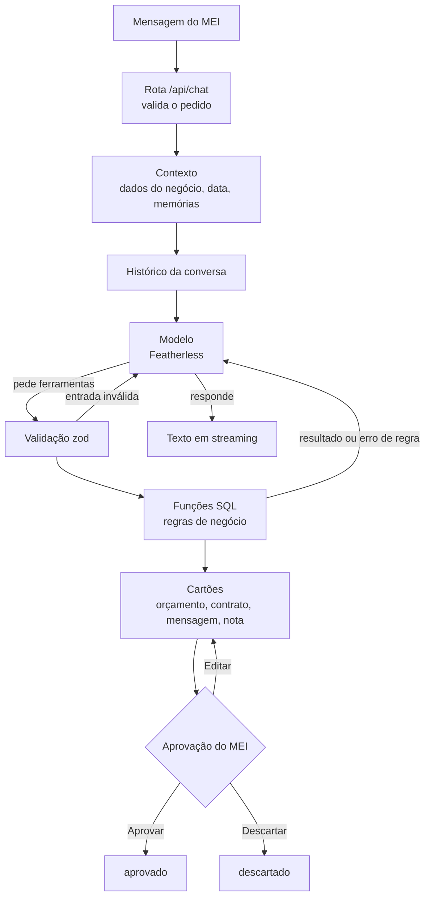

<div align="center">

<h1>Fluxo do agente</h1>

<p>Inputs, lógica e outputs do agente do MEIagente · AKCIT Camp 2026, Edição Regional Nordeste</p>

</div>

<br/>

## Visão geral

O MEI escreve um pedido em linguagem natural no chat. O agente monta o contexto do negócio, chama o modelo e executa as ferramentas que o modelo pedir, sempre passando pelas regras de negócio no banco. Tudo o que sai para fora (orçamento, contrato, mensagem, nota fiscal) vira um rascunho num cartão, e só o MEI decide se aprova, edita ou descarta.



<sub>Arquivos principais: <code>src/app/api/chat/route.ts</code>, <code>src/lib/agente/loop.ts</code>, <code>src/lib/agente/ferramentas/</code> e <code>src/app/painel/agente/Cartao.tsx</code>.</sub>

<br/>

## 1. Inputs

O que entra em cada turno do agente.

| Input | De onde vem | Como chega ao modelo |
|:---|:---|:---|
| **Texto do MEI** | Chat do painel, pela rota `POST /api/chat` | Mensagem do usuário. A rota recusa texto vazio ou com mais de 4.000 caracteres. |
| **Histórico** | Conversa gravada no banco (`06-agente.sql`) | Mensagens anteriores da conversa, limitadas às últimas 40 mensagens ou 40 mil caracteres (`limitarHistorico`, em `llm.ts`). |
| **Dados do negócio** | Cadastro do MEI | Bloco `<contexto_do_negocio>` prefixado ao texto: data de hoje com o dia da semana (fuso de São Paulo), nome do negócio, atividade, cidade e chave Pix. |
| **Memórias** | `memoria_listar` | Entram no mesmo bloco como "Fatos guardados". O próprio agente grava novas com a ferramenta `salvar_memoria`. |
| **Base de conhecimento** | `conhecimento_buscar` (`10-conhecimento.sql`) | Não vai no contexto: o modelo consulta quando precisa, com a ferramenta `consultar_conhecimento` (preços, dúvidas frequentes, políticas e histórico de clientes). |
| **Instruções fixas** | `PROMPT_SISTEMA` (`prompt.ts`) | Prompt do sistema, sempre o mesmo texto, para aproveitar o cache do provedor. O que muda a cada turno vai no bloco de contexto. |

> [!NOTE]
> O bloco de contexto é limpo antes de entrar: o texto vira uma linha só e perde as tags `<contexto_do_negocio>`, para que nenhum dado digitado consiga fechar o bloco e se passar por instrução (`contexto.ts`).

<br/>

## 2. Lógica

### O laço de um turno

`rodarTurno` (`src/lib/agente/loop.ts`) cuida de um turno inteiro e nunca lança exceção: toda falha vira um evento `erro`.

| Passo | O que acontece |
|:---|:---|
| **1. Abre a conversa** | Com `conversaId`, lê o histórico e confere que a conversa é deste MEI. Sem ele, cria uma conversa nova com título tirado do texto. |
| **2. Confere o limite do dia** | Se o uso de tokens de hoje já chegou ao limite diário, para aqui com a mensagem "Você atingiu o limite de uso de hoje." |
| **3. Grava a mensagem do MEI** | Antes de chamar o modelo, para nada se perder. |
| **4. Chama o modelo** | Envia o prompt do sistema, o histórico e a lista das 20 ferramentas. O texto da resposta sai em streaming, pedaço por pedaço. O uso de tokens da volta é somado ao dia. |
| **5. Decide pelo resultado** | Sem chamadas de ferramenta, grava a resposta e encerra o turno. Com chamadas, segue para o passo 6. Volta que terminou mal (filtro, corte por tamanho, motivo desconhecido) não é gravada. |
| **6. Executa as ferramentas** | Em ordem, uma de cada vez, porque uma pode depender do efeito da anterior no banco. Cada resultado vira um evento `ferramenta` e, quando houver rascunho, um evento `cartao`. |
| **7. Grava a volta** | Grava junto a mensagem do assistente (com os cartões) e a mensagem com todos os resultados. O histórico nunca fica com uma chamada sem resultado. Cada chamada é registrada em `agente_acoes`. |
| **8. Volta ao modelo** | O modelo recebe os resultados e decide se chama mais ferramentas ou responde. Repete do passo 4. |

### MAX_VOLTAS

Cada turno tem no máximo **8 voltas do modelo** (`MAX_VOLTAS = 8`). Se a oitava volta ainda pedir ferramentas, nada é executado e o MEI recebe: "Parei depois de muitas etapas seguidas. Diga como quer continuar." É o teto de etapas por pedido e um dos controles de custo.

### Como o modelo escolhe as ferramentas

O modelo recebe o nome, uma descrição curta e o esquema de entrada de cada ferramenta (`definicoes.ts`). A escolha é dele, guiada pelo prompt do sistema, que define regras de trabalho como:

- procurar o cliente com `buscar_cliente` antes de criar um novo;
- registrar logo o que já dá, conferir `listar_dados_faltantes` e perguntar tudo o que falta numa mensagem só;
- converter datas relativas ("sexta que vem") para `AAAA-MM-DD` a partir da data de hoje do contexto;
- não inventar valores, datas ou dados do cliente;
- consultar `consultar_conhecimento` antes de falar de preço, política, dúvida frequente ou histórico de cliente;
- preparar nota fiscal só depois do serviço executado e usar `consultar_faturamento` em vez de somar de cabeça.

### Validação zod

Toda entrada passa pelo esquema `zod` da ferramenta antes de qualquer acesso ao banco (`executar.ts`). Ids precisam ser UUID, datas `AAAA-MM-DD`, horas `HH:MM`, formas de pagamento e status vêm de listas fechadas, e mensagens têm no máximo 2.000 caracteres.

### Regras no SQL

Depois de validada, a entrada vai para uma função SQL (`supabase/02` a `11`). É ali que moram as regras de negócio: transições de status do serviço, valor maior que zero, cliente sem duplicata, documento aprovado que não pode ser refeito, CPF ou CNPJ com dígito verificador correto. Quando uma regra barra, a função lança `regra: <frase para o usuário>`, e essa frase volta ao modelo como erro.

### Quando algo não serve

| Situação | O que acontece |
|:---|:---|
| **Entrada inválida** | A ferramenta não executa. O modelo recebe `{"entrada_invalida": [...]}` com cada campo e o problema, e pode corrigir na volta seguinte. |
| **Ferramenta desconhecida** | O modelo recebe `{"erro": "ferramenta desconhecida: <nome>"}`. |
| **Regra de negócio barrou** | O modelo recebe `{"erro": "<frase da regra>"}` e, pelo prompt, explica o problema ao MEI e diz o que precisa para resolver. |
| **Erro inesperado no banco** | O modelo recebe `{"erro": "erro interno, tente de novo"}`. O detalhe fica só no log do servidor. |
| **Nenhuma ferramenta serve** | O modelo responde só com texto: pergunta o que falta ou diz que não sabe. Não existe ferramenta de envio de mensagem nem de emissão de nota, então esses pedidos sempre terminam em rascunho. |
| **Nada na base de conhecimento** | `consultar_conhecimento` devolve resultado vazio com o aviso "Não invente: pergunte ao usuário." |

> [!IMPORTANT]
> Erro de ferramenta nunca derruba o turno. Ele vira um resultado com `erro: true`, o modelo lê e segue a conversa.

<br/>

## 3. Ferramentas

São 20 ferramentas, definidas em `src/lib/agente/ferramentas/definicoes.ts` e executadas em `executar.ts`.

<details>
<summary><b>Ver as 20 ferramentas</b></summary>
<br/>

| # | Ferramenta | O que faz | Grava dados | Gera cartão |
|:---:|:---|:---|:---:|:---:|
| 1 | `buscar_cliente` | Busca clientes por nome ou telefone (até 10). | não | não |
| 2 | `criar_ou_atualizar_cliente` | Cria cliente ou atualiza por id ou WhatsApp; campo omitido não apaga o atual. | sim | não |
| 3 | `registrar_servico` | Registra um serviço do cliente; `fechado=true` faz o serviço nascer `confirmado`. | sim | não |
| 4 | `atualizar_servico` | Completa ou corrige descrição, valor, data prevista, local ou forma de pagamento. | sim | não |
| 5 | `listar_dados_faltantes` | Lista o que falta no serviço e no cliente para orçamento e contrato. | não | não |
| 6 | `listar_servicos` | Lista serviços, opcionalmente por status. | não | não |
| 7 | `mudar_status_servico` | Muda o status para confirmado, executado ou cancelado. | sim | não |
| 8 | `gerar_orcamento` | Gera rascunho de orçamento, com itens e validade opcionais. | sim | orçamento |
| 9 | `gerar_minuta_contrato` | Gera rascunho de minuta de contrato com os dados do cadastro. | sim | contrato |
| 10 | `redigir_mensagem` | Cria rascunho de mensagem de WhatsApp (confirmação, envio de orçamento, lembrete, cobrança, envio de nota ou outro). Não envia. | sim | mensagem |
| 11 | `salvar_rascunho_post` | Salva rascunho de post para o Instagram. Não publica. | sim | mensagem |
| 12 | `agendar_servico` | Agenda ou reagenda serviço confirmado, no horário de Brasília. | sim | não |
| 13 | `consultar_agenda` | Lista agendamentos entre duas datas. | não | não |
| 14 | `listar_propostas_pendentes` | Lista orçamentos enviados sem resposta há N dias (padrão 3). | não | não |
| 15 | `registrar_pagamento` | Registra pagamento recebido de um serviço. | sim | não |
| 16 | `salvar_memoria` | Guarda um fato duradouro sobre o negócio. | sim | não |
| 17 | `preparar_nota_fiscal` | Prepara rascunho da NFS-e de um serviço executado, com os dados do cadastro. Não emite. | sim | nota |
| 18 | `salvar_documento_cliente` | Salva o CPF ou CNPJ do cliente, necessário para a nota. | sim | não |
| 19 | `consultar_faturamento` | Faturamento do ano frente ao limite do MEI. | não | não |
| 20 | `consultar_conhecimento` | Busca no histórico de clientes, preços, dúvidas frequentes e políticas do negócio. | não | não |

</details>

> [!NOTE]
> Algumas saídas são resumidas de propósito para o modelo. A minuta inteira e os dados da nota (valor, tomador, códigos, competência) ficam só no cartão: o modelo recebe o id, o status e o que falta, e nunca reescreve esses valores.

<br/>

## 4. Outputs

### Eventos em streaming

A rota `/api/chat` responde em NDJSON (um JSON por linha). Os eventos chegam nesta ordem:

| Evento | Conteúdo | Quando |
|:---|:---|:---|
| `texto` | `delta`: um pedaço da resposta | Enquanto o modelo escreve |
| `ferramenta` | `nome` e `erro` | A cada ferramenta executada |
| `cartao` | `cartao`: `{tipo, id}` | Quando uma ferramenta cria um rascunho |
| `erro` | `mensagem` em português | Quando algo falha; não encerra o turno |
| `fim` | `conversaId` | Sempre fecha o turno quando há conversa, também depois de `erro` |

Antes do streaming, a rota pode responder 401 (sem sessão), 400 (pedido inválido), 409 (usuário sem negócio cadastrado) ou 500 (falha ao preparar o turno).

### Cartões

| Cartão | Ações no rascunho | Depois de aprovado |
|:---|:---|:---|
| **Orçamento** | Aprovar, Editar, Descartar | Fica aprovado; o banco recusa regerar documento já aprovado. |
| **Contrato** (minuta) | Aprovar, Editar, Descartar | Fica aprovado; a minuta é ponto de partida e não substitui orientação jurídica. |
| **Mensagem** (WhatsApp ou post) | Aprovar, Editar, Descartar | Copiar, Abrir no WhatsApp (se o cliente tiver número) e Marcar como enviada. |
| **Nota fiscal** | Copiar cada campo, conferir os avisos, Aprovar, Descartar | Abrir o Emissor Nacional e Registrar emissão (XML ou número e valor). Emitida: Mandar para o cliente. |

### Estados

| Item | Estados |
|:---|:---|
| Orçamento, contrato e mensagem | `rascunho` → `aprovado` ou `descartado`. Mensagem aprovada pode virar `enviado` quando o MEI marca que enviou. |
| Nota fiscal | `rascunho` → `aprovado` → `emitida`, ou `divergente` quando a nota registrada não bate com o rascunho. Também `descartado` e `cancelada`. |

> [!IMPORTANT]
> Nada sai sozinho. O agente só cria rascunhos; enviar a mensagem e emitir a nota são sempre ações do MEI, fora do sistema. Decidir duas vezes o mesmo cartão não muda nada.

<br/>

## 5. Guardrails e falhas

| Guardrail | Como funciona | Onde está |
|:---|:---|:---|
| **Limite diário de tokens** | Soma entrada e saída de cada volta por MEI e por dia (fuso de São Paulo). Padrão de 400 mil tokens, configurável em `AGENTE_LIMITE_DIARIO_TOKENS`. | `src/lib/agente/uso.ts` |
| **Teto de voltas** | No máximo 8 voltas do modelo por mensagem. | `MAX_VOLTAS`, em `loop.ts` |
| **Histórico limitado** | No máximo 40 mensagens ou 40 mil caracteres enviados ao modelo. | `limitarHistorico`, em `llm.ts` |
| **Histórico consistente** | Volta que falha no meio não é gravada; a conversa continua utilizável. | `loop.ts` |
| **Auditoria** | Toda chamada de ferramenta fica em `agente_acoes` com entrada, saída, erro e autor, protegida por RLS. As decisões do MEI nos cartões também ficam registradas. | `supabase/06-agente.sql` |

### Erros em português

Toda falha chega ao MEI como uma frase que diz o que fazer em seguida.

<details>
<summary><b>Ver as mensagens de erro</b></summary>
<br/>

| Situação | Mensagem |
|:---|:---|
| Limite do dia atingido | Você atingiu o limite de uso de hoje. |
| Filtro de conteúdo do modelo | A resposta foi bloqueada pelo filtro de conteúdo do modelo. Tente dizer de outro jeito. |
| Resposta cortada por tamanho | A resposta ficou longa demais e foi cortada. Tente pedir uma coisa de cada vez. |
| Modelo parou sem motivo conhecido | O modelo parou sem terminar a resposta. Tente de novo. |
| Teto de voltas | Parei depois de muitas etapas seguidas. Diga como quer continuar. |
| Muitos pedidos ao modelo (429) | O modelo recebeu muitos pedidos ao mesmo tempo. Tente de novo em alguns segundos. |
| Modelo sem capacidade (503) | O modelo está sem capacidade agora. Tente de novo em alguns minutos. |
| Chave recusada (401/403) | A chave do modelo foi recusada. Confira a FEATHERLESS_API_KEY. |
| Conversa grande demais para o modelo | A conversa ficou longa demais para o modelo. Comece uma conversa nova. |
| Sem conexão com o modelo | Não consegui falar com o modelo. Confira a conexão e tente de novo. |
| Erro interno | Algo deu errado do nosso lado. Tente de novo. |
| Mensagem acima de 4.000 caracteres | A mensagem passou de 4000 caracteres. Divida em partes menores. |
| Usuário sem negócio cadastrado | Cadastre o seu negócio antes de falar com o agente. |

</details>

<br/>

## 6. Exemplo completo: instalação de ar-condicionado

O cenário da seção 3 do [README](../README.md#3-exemplo-de-uso), passo a passo pelo fluxo.

> [!NOTE]
> A ordem das ferramentas abaixo é a esperada pelas regras do prompt e do banco, mas quem decide é o modelo, então pode variar entre execuções. O script `scripts/agente-smoke.ts` roda esse cenário contra o modelo real e considera aprovado quando saem 3 cartões, o serviço fica `confirmado` e nenhuma ferramenta recebe `entrada_invalida`.

### Turno 1

**Input**

```text
<contexto_do_negocio>
Hoje: AAAA-MM-DD (dia da semana)
Negócio: <nome do negócio>
Atividade: <atividade>
...
</contexto_do_negocio>

Fechei uma instalação de ar-condicionado por R$ 800 para sexta.
```

**Lógica.** `registrar_servico` exige `cliente_id`, e a mensagem não traz cliente. Pelo prompt, o modelo não inventa dados e pergunta tudo o que falta numa mensagem só.

**Output.** Texto em streaming pedindo nome e WhatsApp do cliente, endereço e forma de pagamento. Eventos: `texto`, `fim`.

### Turno 2

**Input**

```text
Maria Souza, 62 9XXXX-XXXX, Setor Bueno. Pix na entrega.
```

**Lógica.** Sequência esperada de ferramentas:

| Ordem | Ferramenta | Entrada principal | Resultado |
|:---:|:---|:---|:---|
| 1 | `buscar_cliente` | `termo: "Maria Souza"` | Nenhum cliente encontrado |
| 2 | `criar_ou_atualizar_cliente` | nome, WhatsApp e endereço | Cliente criado |
| 3 | `registrar_servico` | `cliente_id`, descrição, `valor: 800`, `data_prevista` da sexta, `local`, `forma_pagamento: "pix"`, `fechado: true` | Serviço nasce `confirmado` |
| 4 | `listar_dados_faltantes` | `servico_id` | O que ainda falta para orçamento e contrato |
| 5 | `gerar_orcamento` | `servico_id` | Rascunho de orçamento; o serviço continua `confirmado` |
| 6 | `gerar_minuta_contrato` | `servico_id` | Rascunho de minuta |
| 7 | `redigir_mensagem` | `objetivo: "confirmacao"`, `cliente_id`, `servico_id`, `conteudo` | Rascunho de mensagem; se o texto citar valor diferente do serviço, volta um aviso |

Cada chamada passa pela validação zod, pela função SQL correspondente e fica registrada em `agente_acoes`. As 7 chamadas cabem com folga nas 8 voltas, porque o modelo pode pedir várias ferramentas na mesma volta.

**Output**

| Saída | Conteúdo |
|:---|:---|
| Texto | Uma frase dizendo o que foi preparado e o que revisar, sem repetir o conteúdo dos cartões |
| Cartão 1 | Orçamento (R$ 800, Pix na entrega) em `rascunho` |
| Cartão 2 | Minuta de contrato em `rascunho` |
| Cartão 3 | Mensagem de confirmação para a Maria em `rascunho` |
| Eventos | `ferramenta` (7 vezes), `cartao` (3 vezes), `texto`, `fim` |

### Depois do turno

O MEI aprova, edita ou descarta cada cartão. A mensagem aprovada pode ser copiada ou aberta no WhatsApp e, depois de enviada por ele, marcada como enviada. A agenda fica para quando o horário for informado: `agendar_servico` exige data e hora (`HH:MM`).

<br/>

<div align="center">
<sub>Parte da documentação do MEIagente. Veja também o <a href="../README.md">README</a> e o <a href="bmc.md">Business Model Canvas</a>.</sub>
</div>
